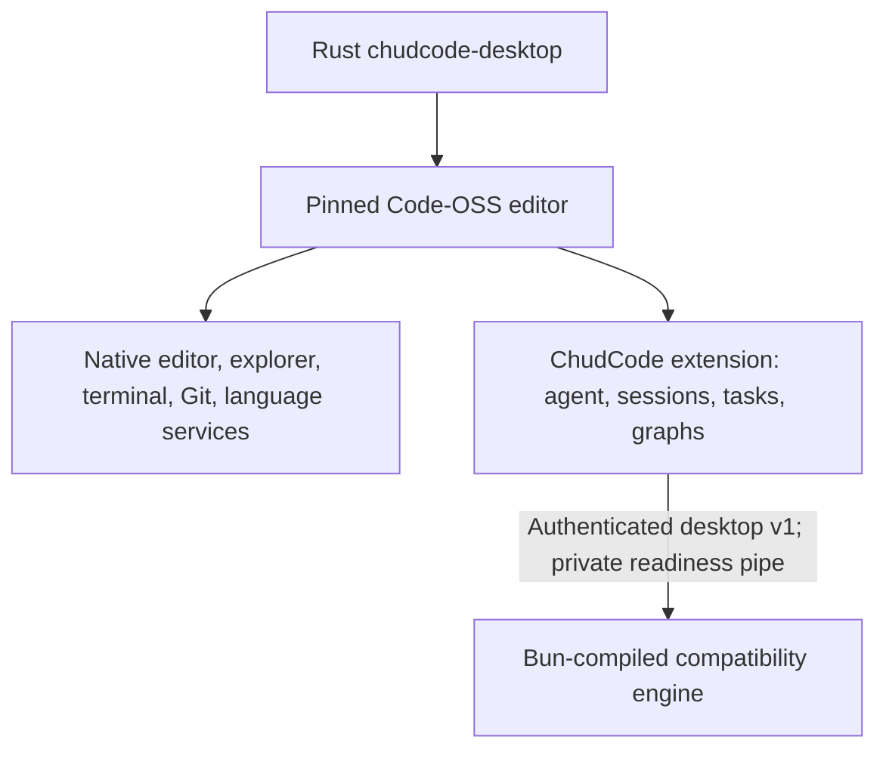

# Agent desktop shell

Browser-based IDE shell for the internal agent runtime. A local Bun process owns
the agent session and machine-facing services; a React application connects to
it over an authenticated loopback WebSocket.

This package contains no CAD proprietary assets, CAD source, CAD runtime, CAD
protocol, or CAD-derived presentation code.

The browser shell documented below remains available unchanged for stable
rollback. The separate [Code-OSS workbench candidate](#code-oss-workbench-candidate)
uses this package's compatibility service, not its browser IDE shell.

## Architecture

```text
Chromium app window or default browser
  React shell
    ├─ Monaco editor + workspace tree/search
    ├─ xterm.js terminal
    ├─ Git changes/diff/history
    ├─ D3 code/Git/agent graphs
    └─ reused collaboration transcript/composer/agent UI
             │
             │ authenticated HTTP + ordered JSON WebSocket frames
             ▼
Bun loopback server (127.0.0.1 only)
  ├─ DesktopRuntime / SessionService → agent session
  └─ ServiceRouter
       ├─ WorkspaceService + FileWatcher + WorkspaceSearch
       ├─ TerminalService → chud-natives PTY/process
       ├─ GitService → local git executable
       ├─ LspBroker → explicitly trusted local language servers
       └─ GraphService → graphify-out, LSP, Git, and agent registry
```

The layers are deliberately separated:

- `src/protocol.ts` is the typed request/response/event contract shared by host and browser.
- `src/server.ts` serves immutable web assets, authenticates HTTP/WebSocket requests, bounds frame queues, and owns the single-instance lease.
- `src/runtime.ts` adapts agent/session events to desktop frames.
- `src/service-router.ts` routes machine-facing methods without exposing arbitrary commands over the wire.
- `src/services/` owns workspace containment, file watching/search, Git, terminal, and trusted LSP processes.
- `src/graph-service.ts` adapts Graphify, LSP, Git, and the live agent registry to one graph snapshot contract.
- `src/web/desktop-client.ts` and `desktop-store.ts` maintain the ordered client connection and external-store state.
- `src/web/` contains the React shell and the editor, terminal, Git, graph, session, task, transcript, composer, and agent surfaces.

The browser is a view/controller, not a privileged filesystem process. Workspace, Git, terminal, LSP, and agent operations cross the typed local protocol and are revalidated by the host.

## Requirements

- Bun **1.4.0**, matching the repository `packageManager` pin.
- A supported desktop browser. The launcher prefers Chromium, Chrome, Brave, or Edge in app-window mode and falls back to the OS default browser.
- `git` on `PATH` for source-control features.
- Platform-compatible `@oh-my-pi/pi-natives` artifacts for PTY and native workspace search.
- Language-server executables only when the embedding host supplies trusted LSP specifications; none are launched from browser-provided command lines.

Install the monorepo dependencies from the repository root:

```sh
bun install --frozen-lockfile
```

## Build

From the repository root:

```sh
bun --cwd packages/chudcode-desktop run build
```

This creates:

- `packages/chudcode-desktop/dist/web/` — minified browser HTML, JavaScript, CSS, Monaco workers, and assets.
- `packages/chudcode-desktop/dist/chudcode-desktop[.exe]` — a compiled standalone server/launcher with its Bun runtime and JavaScript dependency graph embedded.

The packaging script `scripts/package-chudcode-desktop.ts` assembles the compiled CLI, desktop launcher, native GUI, adjacent runtime assets, version metadata, and repository notices. The archive contains no source tree, `node_modules`, or Bun interpreter dependency.

## Run

Inside an unpacked release archive, the compiled launcher resolves `chud`, `chudcode-gui`, `web/`, `assets/`, `VERSION`, and notices only beside its own executable. It launches the adjacent native GUI by default:

```sh
./chudcode-desktop
```

Use `--browser` to attach a browser client instead. Packaged mode fails before starting the server if any adjacent component is absent.

Source execution is intentionally explicit and accepted only in this checkout with built web assets:

```sh
bun packages/chudcode-desktop/src/launch.ts --source-mode
```

The launcher uses the current project directory as the initial workspace context, creates a single-instance lease under the agent runtime directory, and reuses the existing desktop process when one is already active.

The isolated Code-OSS candidate uses `src/workbench-host.ts` instead. It opens
`--workspace <absolute directory>` before emitting one authenticated readiness
line, and stops on owner stdin EOF or SIGINT/SIGTERM. `--version` and
`--build-info` return service identity without starting the desktop runtime.
The host statically imports the ESM runtime graph to preserve Bun file-asset
import attributes; it does not use a synchronous runtime `require` or
module-level await. Bundled workers reuse the importable compatibility CLI
dispatcher, and process lifetime cleanup uses the centralized postmortem path
after runtime disposal rather than leaving background discovery alive.

## Code-OSS workbench candidate

This is an **opt-in, unpublished compatibility-first candidate**, separate from
the existing desktop/CLI release pipeline. `crates/chudcode-desktop` supplies a
native Rust launcher; `packages/chudcode-workbench` supplies a Node/esbuild-built
Code-OSS extension. Bun and TypeScript remain the real agent/provider/plugin
engine until native replacements pass parity gates. Electron/Node/TypeScript
intentionally remain at the editor boundary; launching a compiled compatibility
service does not make the agent engine Rust-native.

### Architecture and provenance



The editor base consists of official VSCodium **1.135.06055** archives pinned
by URL, size, and SHA-256 in
[`packaging/workbench/base.json`](../../packaging/workbench/base.json).
The product overlay gives it ChudCode identity, retains **Open VSX** rather
than Microsoft's Marketplace, and disables upstream auto-update so the candidate
cannot silently update into plain VSCodium. Upstream licenses/notices and
candidate provenance are retained. This is assembly from pinned upstream
binaries, **not a published upstream source fork** and not a Microsoft-built
or Microsoft-signed product. Modified upstream resources still need candidate
signing/notarization qualification.

The extension owns one service per trusted window/workspace. It starts no
agent service before workspace trust is granted; no open folder means no
workspace service. The service's private stdout readiness pipe carries its
loopback URLs and token; diagnostics go to stderr. Owner EOF and termination
dispose the transport, runtime, and owned children. Service failure is visible;
restart is explicit through **ChudCode: Restart Service**, not a hidden
fallback. The nonpresenting `/ws?client=control` connection does not hold UI
requests open, and trusted `rootPath` bridge metadata survives zero session
tabs. Existing default desktop-client behavior is unchanged.

Persisted-session listing, rename, deletion, and pinning remain available after
the final session tab closes. The catalog owns no live agent resources;
selecting a stored session or creating a new one opens an explicit live session,
while running and dirty tabs retain their close/delete protections. Workspace
root metadata and graph access continue independently of session tabs.

### Candidate layout and native-host assembly

```text
<candidate>/
  chudcode-desktop[.exe]    Rust launcher
  chud[.exe]               public compatibility CLI (0.4.3 / RPC v2)
  chudcode-service[.exe]    private desktop v1 compatibility service
  editor/                 pinned upstream editor and built-in extension
  VERSION
  candidate-manifest.json
  notices/                repository notices and PROVENANCE.txt
```

The extension is installed under the editor's `resources/app/extensions/`
tree (inside the app bundle on macOS). The launcher resolves trusted payload
paths relative to itself, not the working directory or `PATH`, and forwards
editor arguments without a shell.

Build from the repository root with the pinned monorepo dependencies already
installed, Node, Bun, Rust/Cargo, and matching native addon inputs available.
Use absolute input/output paths and a new candidate directory; do not point
assembly at an installed stable release. This Linux x64 example does not
download the base archive or install dependencies:

```sh
engine=/absolute/path/to/new-engine
candidate=/absolute/path/to/new-candidate
base_archive=/absolute/path/to/pinned-VSCodium-archive.tar.gz

bun packages/chudcode-workbench/scripts/build-engine.ts \
  --output "$engine" --target linux-x64
node packages/chudcode-workbench/scripts/build.mjs
cargo build --release -p chudcode-desktop

python3 scripts/package_chudcode_workbench.py \
  --target linux-x64 \
  --base-archive "$base_archive" \
  --launcher "$PWD/target/release/chudcode-desktop" \
  --service "$engine/chudcode-service" \
  --chud "$engine/chud" \
  --extension packages/chudcode-workbench \
  --output "$candidate"
```

Supported assembler target names are `linux-x64`, `darwin-x64`, and
`win32-x64`; the engine builder spells those targets `linux-x64`,
`macos-x64`, and `windows-x64`. Windows executable inputs carry `.exe`.
These are assembly targets, not claims of completed platform qualification.
Assembly **must run on the matching native x64 host** for executable identity
probes; cross-host assembly is rejected.

The fail-closed assembler checks the archive size/SHA-256, safe extraction,
native ELF/PE/Mach-O architecture, actual executable role/version, built
extension outputs, and required notices. It records binary evidence, file
inventory, provenance, and unresolved qualification in the candidate manifest.
Publication to the local output directory is atomic and refuses to replace
an existing destination. It does not publish a release, sign binaries, or
replace user installations.

### Launch, trust, privacy, and rollback

```sh
"$candidate/chudcode-desktop" --check
"$candidate/chudcode-desktop" /absolute/path/to/trusted-workspace
```

`--check` reports native launcher metadata and required payload paths without
opening the GUI. Normal launch preserves Electron's sandbox; do not pass
`--no-sandbox` to bypass host setup.

The default editor user-data/extensions locations are separate from VS Code,
VSCodium, and the old GUI:

| Host | Editor user data | User-installed extensions |
| --- | --- | --- |
| Linux | `${XDG_CONFIG_HOME:-~/.config}/chudcode-workbench` | `${XDG_DATA_HOME:-~/.local/share}/chudcode-workbench/extensions` |
| macOS | `~/Library/Application Support/Chudcode Workbench` | `~/.chudcode-workbench/extensions` |
| Windows | `%APPDATA%/Chudcode Workbench` | `%USERPROFILE%/.chudcode-workbench/extensions` |

Shared editor storage uses `.chudcode-workbench-shared` under the user's home,
not stock Code-OSS storage. macOS keeps the upstream internal bundle/helper
names required by Electron while using Chudcode's display name, bundle identifier,
and editor profile.

Explicit editor `--user-data-dir` and `--extensions-dir` arguments are honored
for isolated qualification; choose separate directories rather than reusing
another product's state. **Agent settings and session files still use the
existing Chudcode runtime store**: editor isolation is not a copy or migration
of that store. Back up important agent state before candidate evaluation.

The bearer token stays in the extension host/private pipe, never the webview,
settings, logs, disk, or command line. Webview network access is disabled by
CSP; typed messages cross the extension bridge, and file navigation is confined
to the trusted workspace, including symlinks. The service remains loopback-only,
single-user, and unsuitable for tunnels or remote publication.

Workspace trust and Electron's sandbox do not sandbox terminal/agent tools:
they run with the user's permissions and may use existing provider credentials,
plugins, host tools, Git credentials, and network access. Local transport does
not imply that prompts/files stay local when a remote provider or tool is used.
Review the workspace and installed extensions, use least privilege, and avoid
credentials during isolated tests unless explicitly qualifying a provider.

Rollback means close the candidate and launch the existing stable GUI or CLI.
No stable installer, artifact name/version, downstream pin, or existing GUI
source is replaced by this workflow. Candidate editor state can remain separate;
do not delete the shared agent store as a rollback step.

### Qualification evidence and stable promotion gates

The following are candidate checks, not stable-release certification:

```sh
"$candidate/chudcode-desktop" --check
"$candidate/chud" --smoke-test
"$candidate/chudcode-service" --smoke-test
python3 scripts/smoke_chudcode_workbench.py --bundle "$candidate"
xvfb-run -a python3 packages/chudcode-workbench/test/run_extension_host.py \
  --bundle "$candidate"
```

For a distributable archive, run the native qualification command after building
the launcher, engine, and extension:

```sh
python3 packages/chudcode-workbench/scripts/qualify.py \
  --output /absolute/fresh-qualification-output \
  --launcher target/release/chudcode-desktop \
  --engine /absolute/built-engine
```

On Windows, use `python` and the `.exe` launcher. `--base-archive` can reuse an
already downloaded pinned archive. The command verifies the base, safely
round-trips the distributable archive, executes both worker probes and the real
desktop/RPC/editor checks, then publishes an archive, checksum, and hash-bound
qualification report without overwriting existing output. Linux requires
`xvfb-run`; missing native execution is a failure, not a skip. macOS ad-hoc
re-signing preserves observed Electron entitlements but is not Developer ID
signing or notarization. Signing prerequisite observations do not imply trust.
The probes support Python 3.9 and newer. The Windows lane uses `uv` to obtain
portable Python in product-private storage, without a system Python installer.
Windows probes translate validated native canonical paths to the launcher's
ordinary path spelling before passing them to Code-OSS URI/module loaders.
Editor probes enable verbose startup output; command timeouts retain bounded
stdout/stderr diagnostics without preserving private application profiles.

Live-provider qualification is a separate, explicit opt-in:

```sh
python3 packages/chudcode-workbench/test/run_live_provider.py \
  --bundle "$candidate" --base-url http://127.0.0.1:19341 --model qwen3:8b
```

Use an already installed tool-capable Ollama model and a daemon configured for
at least 32768 context tokens; the model's advertised maximum alone is
insufficient. Prefer a separate daemon with `OLLAMA_CONTEXT_LENGTH=32768`
rather than reconfiguring a shared provider. The probe isolates application
state, disables other providers, and verifies model-generated tool calls,
unchanged inputs, and computed file bytes through desktop v1 and public RPC v2.
Its JSON evidence fingerprints the candidate manifest, tested engines, probe,
and prompt without retaining transcripts or credentials.

The current Linux candidate passed both real-provider paths with `qwen3:8b`.
Earlier trials failed provider/output gates; this is functional smoke evidence,
not a completion-reliability or performance certification.

The manual **Workbench release qualification** workflow (`workbench.yml`) runs
on the product-private Linux, Intel Mac, and Windows builders:

```sh
gh workflow run workbench.yml --repo Hunter-124/chudcode --ref main
```

It stages native addons and qualified outputs through a separate draft release,
`chudcode-workbench-v<product-version>-rc.<run-number>`, bound to the exact source
commit. It never modifies the published product release or latest-release
pointer. Reports distinguish native execution from signing, live-provider,
deployed-consumer, and accessibility qualification. Candidate tags must not
become the product's latest release: the CLI updater expects the product tag
namespace. Stable promotion belongs in a subsequent qualified product release,
with existing published versions and downstream pins preserved.

Observed on the current Linux host: `bun check`, the Rust gate (3087 passing
tests, six skipped, plus doctests), desktop tests (146), compiled service tests
(seven), isolated SDK tests (92 plus 19 subtests), and assembler tests (17)
passed. Real compiled CLI/service worker probes, assembled desktop v1/RPC v2
smoke, owner-EOF cleanup, and the actual CAD
`scripts/smoke_chudcode_runtime.py` with candidate `chud` 0.4.3 also passed.
The CAD script belongs to the downstream checkout, not this repository.
Local CloudCastle context-engine and Discord integration suites passed all 198
tests. Cargo and Bazel launcher builds, the Bazel launcher test target, and the
Bazel-built launcher's role/version probe also passed. These local suites do not
qualify deployed CloudCastle.

The assembled Code-OSS extension-host integration passed. Interactive Linux
verification exercised file edit/save, native terminal output, Git changes,
draft restoration across session switches, workspace trust, no-folder startup,
zero-tab catalog access and webview recreation, new sessions, and the live agent
graph. These no-provider editor checks do not certify live providers,
accessibility workflows, or other operating systems.

The native editor regression also verifies that switching sessions preserves
service-owned dirty-draft state. Initializing an empty webview composer does not
clear another connection's draft flag; observed closed-tab drafts are discarded.

Code graphs still require Graphify output or a trusted service-side LSP
configuration. Installing an editor language extension alone does not configure
the compatibility service; missing graph sources fail visibly.

Final-bundle current-host observations were service readiness **1723 ms** and
CLI RPC readiness **338 ms**. They are not comparative benchmarks or evidence of
a speedup. Profile comparative startup, latency, memory, and CPU distributions
with controlled workloads before making performance claims.

Stable goals and required promotion gates:

- Freeze CAD's **Chudcode 0.4.3 / RPC v2 / Python SDK 0.3.1** and
  CloudCastle's **18.1.11** integration surfaces. Keep public CLI/RPC/SDK
  artifacts, provider policies, and downstream pins unchanged.
- Before replacing engine modules with Rust, prove behavior, restart,
  persistence/session-tree, inherited host-tool, plugin/provider, and compiled
  worker parity against the compatibility engine and actual consumers.
- Complete populated task/subagent workflows, full accessibility verification,
  and the remaining native-platform workflows. Local transport, Linux editor,
  and isolated Ollama checks do not substitute for deployed CloudCastle or
  live CAD/provider qualification.
- Qualify native Windows/macOS and ARM separately, and sign/notarize candidate
  distributions through trusted release lanes. None of those gates is claimed
  here.
- Qualify baseline-x64 ISA on appropriate hardware. The Linux baseline addon
  was built and forced through compiled workers, RPC, and editor qualification
  on the current host using `PI_NATIVE_VARIANT=baseline`. This does not establish
  behavior on a CPU lacking newer instruction sets; reports retain that gap.

Until these gates pass, preserve the stable GUI/CLI rollback and release
pipeline. This candidate is not a completed native overhaul or a stable release.

## Development

The package `dev` script watches the Bun server source. It expects `dist/web/` to exist. For host-only changes:

```sh
bun --cwd packages/chudcode-desktop run build
bun --cwd packages/chudcode-desktop run dev
```

For browser and host changes, use two terminals from the repository root:

```sh
# Terminal 1: rebuild browser assets
bun build packages/chudcode-desktop/src/web/index.html \
  --outdir=packages/chudcode-desktop/dist/web \
  --target=browser --watch

# Terminal 2: restart the host on source changes
bun --cwd packages/chudcode-desktop run dev
```

The dev launcher opens the native GUI. Pass `--browser` directly to the source entrypoint when testing the browser client. The browser build watcher does not provide hot-module replacement; refresh after it emits updated assets.

Useful focused commands:

```sh
# Type-check host and browser projects
bun --cwd packages/chudcode-desktop run check

# Run only this package's tests
bun test packages/chudcode-desktop/test
```

## Security model

This service is intentionally local and single-user:

- Bun binds only to `127.0.0.1`. Host headers must name the active loopback authority and port; supplied origins must be same-port HTTP loopback origins.
- Startup generates a random 32-byte (256-bit) bearer token. Comparisons are constant-time. The bootstrap query token is exchanged for a `HttpOnly; SameSite=Strict` cookie and removed by redirect.
- The bootstrap URL is a secret. Do not paste it into logs, chat, tickets, or remote browser sessions. Anyone able to reach the loopback port and obtain the token acts with the desktop process's user permissions.
- Static responses use `nosniff`, no-referrer, same-origin resource/opener policies, and an app CSP that rejects objects, framing, non-local connections, and non-self scripts.
- WebSocket input is limited to 1 MiB; outbound frames use bounded queues and backpressure handling.
- Static paths are decoded, normalized, checked against traversal, and real-pathed inside `dist/web` before serving.
- Workspace paths are canonicalized and confined to the opened root. Writes use expected content hashes to surface concurrent edits instead of silently overwriting them.
- LSP process commands come only from trusted host settings. Wire requests can request supported LSP operations but cannot choose an executable or arguments.
- Terminal and agent actions are intentionally powerful local operations. Open only trusted workspaces and run the desktop under an account with appropriate least privilege.

Do **not** bind this server to a LAN address, publish it through a tunnel, or place it behind a reverse proxy. It has no remote-user authentication, TLS termination, tenant isolation, or authorization boundary beyond possession of the local token.

## Feature map

| Area | Direct behavior |
| --- | --- |
| Agent sessions | Create, select, fork, rename, pin, and delete local sessions; render transcript/tool activity; submit prompts; inspect and control registered agents. |
| Workspace and editor | Open recent/local roots; browse, create, rename, copy, and remove files/directories; quick-open and content search; Monaco models, tabs, save hashes, file-change conflict comparison, and source navigation. |
| Language services | Host-managed LSP document lifecycle, diagnostics, definition/reference navigation, completion/code-action plumbing, and workspace-symbol search for configured trusted servers. |
| Terminal | Multiple xterm.js tabs backed by local native PTYs, streaming output, resize/fit, paste, reconnect/error states, and orderly process shutdown. |
| Source control | Repository status, staged/unstaged changes, unified and hunk diffs, stage/unstage/revert, commit, branches, remotes, fetch/pull/push/checkout, conflict safeguards, and history. |
| Graphs | Code graph from `graphify-out/graph.json` with trusted-LSP fallback, Git history graph, and live agent/lifecycle graph; zoom, drag, fit, filter, scope, pin, source-open, and list fallback. |
| Shell | Resizable/persisted primary, editor, bottom, and secondary regions; activity routes; sessions/tasks/settings utility views; Chudcode composer/transcript/agent presentation; reconnect and error banners. |
| Theme and motion | Shared semantic color tokens, dark/light system preference, persisted layout, and OS/runtime reduced-motion handling. |

## Keyboard and accessibility

The shell uses semantic landmarks, labeled controls, tab/list/tree roles, live status/error regions, and focusable editor, diff, terminal, and graph surfaces. Icon-only actions carry accessible names. The graph provides both keyboard navigation and an ordered-list fallback. Motion-heavy editor, Git, graph, terminal, and shell effects respect `prefers-reduced-motion`.

Shell shortcuts are ignored while typing in text inputs:

| Shortcut | Action |
| --- | --- |
| `Ctrl+B` | Toggle primary sidebar |
| `Ctrl+Alt+B` | Toggle transcript/agent sidebar |
| `Ctrl+1` | Focus editor host |
| `Ctrl+Shift+E` | Explorer |
| `Ctrl+Shift+F` | Search activity |
| `Ctrl+Shift+G` | Source control |
| `Ctrl+\`` | Terminal |
| `Ctrl+Shift+Y` | Graph |
| `Ctrl+Shift+U` | Sessions/tasks/settings utility |
| `Ctrl/Cmd+P` | Quick Open inside the editor workspace |
| `Ctrl/Cmd+Shift+F` | Search workspace contents inside the editor workspace |

Inside a focused graph, use arrow keys, `Home`/`End`, `Enter`, and `Space` to move among nodes and open source. Monaco and xterm.js expose their own browser accessibility modes and keyboard behavior.

Known accessibility limit: split-pane separators are currently pointer-resized. Keyboard users can use the sidebar shortcuts and reset the persisted layout from Settings, but cannot yet adjust separator dimensions from the keyboard.

## Known platform limits

- This is a browser-hosted desktop shell, not a native WebView application. There is no installer, OS auto-update integration, native menu bar, or offline runtime bundle in this package.
- App-window launch is implemented for Chromium-family executables on Linux, macOS, Windows/Cygwin, and several BSD/Unix variants. When none is found, the OS default-browser command is used; Android and uncommon Unix platforms receive best-effort fallback behavior.
- The service is loopback-only and single-instance per runtime directory. It is not a remote IDE or multi-user collaboration server.
- The server uses plain HTTP because it is confined to loopback. HTTPS origins and non-loopback host/origin headers are rejected.
- Git features require a local Git executable and repository. Network Git actions inherit the user's existing credentials, transport configuration, and connectivity.
- Terminal availability depends on the matching `chud-natives` binary and an executable user shell. The desktop service caps itself at 32 terminal sessions and bounds buffered input/output to prevent unbounded memory growth.
- LSP support is inert until a trusted host configuration supplies installed language servers. The browser cannot install or select arbitrary servers.
- Code graphs prefer a workspace's existing `graphify-out/graph.json`; otherwise they require a configured LSP workspace-symbol provider. Default snapshots are bounded to 250 code nodes, 750 edges, and 64 reference queries.
- Browser storage keeps layout preferences for that browser profile. Session files, workspaces, Git state, terminals, and agent state remain host-owned and are not synced by this package.
- Monaco and xterm browser/screen-reader behavior varies by browser and assistive technology. Chromium-family browsers are the primary app-window target; verify the chosen production browser/AT combination before deployment.

## Licensing

This code is MIT-licensed under the repository `LICENSE`. Direct desktop dependency versions, source URLs, uses, notice locations, and source/binary obligations are recorded in [`THIRD_PARTY_NOTICES.md`](./THIRD_PARTY_NOTICES.md).
